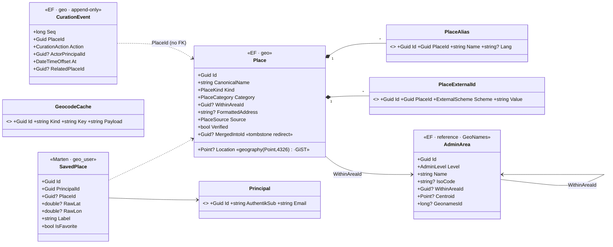

# Architecture

LupiraGeoApi is the geo/gazetteer bounded context for Lupira: a shared catalog of real-world **places** with
coordinates and an administrative containment tree, **geocoding** (forward + reverse), and per-principal **saved
places**. Other services (starting with LupiraCalApi) reference a place by id and resolve free-text locations through
it. It is the long-term home for a Google-Maps-style capability, so spatial storage (PostGIS) is built in from the
start.

## Bounded context & layering

Two projects, split on the architectural boundary (same shape as the other Lupira APIs):

- **`LupiraGeoApi.Core`** — the bounded context. Domain types, the EF `GeoDbContext`, transport-neutral application
  services, DTOs, mappers. No ASP.NET dependency.
- **`LupiraGeoApi`** — a thin ASP.NET host. Minimal-API endpoint groups → handlers → Core services → storage. Auth,
  OpenAPI/Scalar, health checks, and the MCP transport live here.

```
HTTP ─▶ Endpoints/ ─▶ Handlers/ ─▶ Core: Application services ─▶ Marten (geo_user) + EF Core/PostGIS (geo)
  │                       │                     │
  └─ MCP ─▶ Mcp/GeoTools ─┘                  OpResult ──▶ OpResultMap (RFC 7807) on the way back
                       CurrentUser            Nominatim (geocoding) · Photon (address autocomplete) · GeoNames (seed)
```

## Two storage models, one database

Same database (`lupira_geo`), two disjoint schemas — the LupiraCommsApi pattern (EF + Marten side by side):

- **`geo` (EF Core + NetTopologySuite).** The gazetteer + reference data: `Place` (with a real
  `geography(Point,4326)` column + GiST), `PlaceAlias`, `PlaceExternalId`, the `AdminArea` containment tree, and the
  append-only `CurationEvent` log. Spatial and reference-shaped, so it is relational (not event-sourced), applied via
  **EF migrations** — never auto against the live DB, only via the `--apply-schema` one-shot.
- **`geo_user` (Marten documents).** Per-principal state + caches: `Principal` (JIT-provisioned identity),
  `SavedPlace`, and the `GeocodeCache`. Plain document store (`UseLightweightSessions`), no event sourcing.

Marten's schema-diff only inspects `geo_user`, so it never touches the EF tables. `--apply-schema` runs Marten's apply
**and** `GeoDbContext.Database.MigrateAsync()`.

> **PostGIS is untrusted** — the app role cannot `CREATE EXTENSION postgis`. Provisioning creates it once as superuser
> (`deploy/db/grants.sql`); the EF migration's `CREATE EXTENSION IF NOT EXISTS` is then a no-op in prod (and creates it
> in the superuser test container). `pg_trgm` is trusted and self-creates.

## Domain model



## Resolving free-text → a place

`POST /places/resolve` (and the `PlaceResolver`) replaces the old exact-string dedup: (1) match an existing place by
case-insensitive name **or alias**; (2) else forward-geocode via Nominatim and, if coordinates come back, dedupe by
OSM id, then name+proximity (~60 m), or create a `Geocoded` place with coordinates + an on-demand `AdminArea` chain; (3)
else provisionally create an unverified `User` place with no coordinates.

Dedupe is house-number-aware (`HouseNumber`): labels carrying different numbers ("Storgatan 5", "Storgatan 5 B") are
never one place, and a numbered place never matches a hit coarser than it. A hit that does not pin the requested
number (only the street, or another number) is an approximate fix: the place keeps the requested address as its name
and takes the hit's coordinates and containment, but no OSM id and no `FormattedAddress` (both name the street), and it
matches only a place with the same number. Regeocode applies the same rule. Geocoding is optional — with no Nominatim URL
configured it never calls out and step 3 always applies. `POST /places/resolve:batch` runs the same pipeline over up
to 50 texts, responses aligned index-for-index.

## Typeahead

`GET /places/suggest` is the catalog typeahead: trigram `word_similarity` (pg_trgm GIN indexes exist on place names,
aliases, and area names) over places **and** `AdminArea` localities, merged and ranked, discriminated by a
`type` field — cities suggest straight from the GeoNames seed without a gazetteer entry.

## Address search

`GET /geocode/forward` takes free text (`q`) or structured fields (`street` with an optional house number, `postcode`,
`locality`, `countryCode`; `street`, or `postcode` + `locality`, required), plus an `intent`. `ForwardRouting` picks
the backends, first with hits answers (`AddressSearchService`):

| Intent | Backends | Cache |
|---|---|---|
| `Search` (default) | Nominatim (regional → public), then address autocomplete | Nominatim answers frozen |
| `Typeahead` | address autocomplete; unconfigured ⇒ regional Nominatim only | never |

Address autocomplete (`IAddressAutocomplete`) is self-hosted Photon (`Photon:BaseUrl`, Europe extract), adapted in the
host (`PhotonAddressAutocomplete`) to `GeocodeHit`. It is search-as-you-type only: Nominatim stays the canonical
resolver, typeahead never reaches the public Nominatim (its usage policy forbids autocomplete), and suggestions are
never frozen. `nearLat`/`nearLon` bias autocomplete ranking. Hits carry `Street`, `HouseNumber`, `Postcode`, `IsArea`
and the OSM identity.

## Committing a pick

Addresses are catalog places: a home is a `Place` that residencies (LupiraContactApi) reference by id; the personal
label ("Home") is a `SavedPlace`.

`POST /places/from-geocode` lands a picked hit by OSM identity: the frozen results of `query` when given, else
`/lookup` on the regional Nominatim, then the public fallback (one throttled call per commit, frozen under
`osm:W123`). When neither knows the object, the client's copy of the hit (coordinates + address fields) creates an
approximate place — no OSM id, no `FormattedAddress`, containment from a reverse geocode (none if that is down; a
later regeocode heals it). The hit then runs through the resolver's OSM-id → house-number-aware proximity dedupe →
containment. The default name comes from the hit: a venue or settlement keeps its name, an address is
"Street HouseNumber, Locality".

`POST /places/from-pin` creates a `User` place at the exact pin. A building-precision reverse geocode supplies
`FormattedAddress`, containment and the default name ("Street HouseNumber, Locality", else the coordinates). A place
within 25 m with a similar name matches instead (`Matched`/`Created`); equal names far apart are separate places. A
geocoder outage still creates the place from its coordinates.

## Curation: aliases, merge, verify

Aliases (`POST/DELETE /places/{id}/aliases…`) carry alternate names; resolve and suggest match them. Duplicates are
merged (`POST /places/{id}/merge` → `intoPlaceId`) with a **tombstone redirect**: the loser keeps its row with
`MergedIntoId` set, so place ids held by other services (cal) keep resolving — reads by id follow the chain, every
search excludes tombstones. Names move over as aliases and saved places re-point (EF commits first, then Marten — two
commits, not atomic; re-running the same merge converges). The survivor's own fields win; the loser only fills what the
survivor lacks. Coordinates, address, containment and OSM id are one geocode fix, taken from the loser only when the
survivor has no coordinates. Other external ids move only for schemes the survivor lacks; the rest are dropped (logged
`ExternalIdRemoved` on the loser). Verify stays a plain `PATCH` (`verified: true`).

Every curation decision (create/verify/rename/recategorize/alias±/merge) appends a `CurationEvent` in the **same
transaction** as the change — an unbackfillable actor+timestamp trail, and the replay seed if curation is ever
event-sourced. `SavedPlace` uses Marten optimistic concurrency (`409` on a concurrent edit). Neither the gazetteer nor
the cache is event-sourced, by design — see [event-sourcing.md](event-sourcing.md) for the decision and the
conventions any future event stream must follow.

## Geocoding & the cache

`GeocodingService` does forward (`/search`, free text or structured), reverse (`/reverse`) and OSM-identity
(`/lookup`) geocoding, resolve-once-and-freeze into `GeocodeCache` — reverse keyed by a quantized grid cell (~100 m
for `precision=Area`, ~11 m at building zoom for `precision=Building`), forward by the normalized query or structured
fields, lookups by OSM id, all via a deterministic id so retries upsert. Forward hits stay frozen; an empty forward answer expires after a day, and
regeocode always re-asks it (`force=true` also bypasses frozen hits). Two endpoints, tried in order (`NominatimOptions`): the self-hosted regional
instance (`Nominatim:BaseUrl`), then an optional public fallback (`Nominatim:FallbackBaseUrl`) for queries outside the
regional extract's coverage — throttled through `NominatimRateGate` (singleton, ≥1.1 s between requests, per the
public usage policy) with an identifying `Nominatim:UserAgent`. Whichever endpoint answers is frozen, so a foreign
query costs one public call ever. Forward hits must pass `ForwardHitFilter` or count as a miss (so the next endpoint is
asked): a postcode (the structured field, else a 5-digit token in the text) must share the hit's first two digits, and a bare one-word query needs
Nominatim importance ≥ 0.2 inside `Nominatim:RegionalCountries`, ≥ 0.5 elsewhere. Forward fetches 10 candidates so a
passing hit below a rejected one is still found. Any failure or no configured URL returns empty/null and never blocks a resolve.

## Reference-data seed

`--seed-gazetteer` (`GazetteerImporter`) tops up the `AdminArea` tree from GeoNames: `countryInfo.txt` (countries),
`admin1CodesASCII.txt` (regions), `cities500.zip` (localities, with centroids). Idempotent — keyed by `GeonamesId`,
existing rows skipped. Data is CC BY 4.0 (attribution below); files are never committed.

## Identity, auth & MCP

Identity is JIT-provisioned from OIDC claims (`sub` first, then email) into a local `Principal` — the `sub` is the only
cross-service join key. `ApiPolicy` is OIDC JWT bearer (Authentik); Development adds an `X-Dev-User` header handler.
The MCP transport (`/mcp`, read-only find/get/reverse-geocode/saved-places tools) is LAN/WireGuard-only, 404'd at the
edge for any request carrying Cloudflare headers.

## Error handling & transport

Services return a transport-neutral `OpResult`/`OpResult<T>` (`Ok`/`NotFound`/`Forbidden`/`Invalid`/`Conflict`), mapped
in `Lupira.Hosting.Problems` to typed `Results<...>` unions with RFC 7807 problems. Enums serialize as string names.

---

Place data © OpenStreetMap contributors (via Nominatim and Photon), ODbL. Administrative data © GeoNames, CC BY 4.0.
